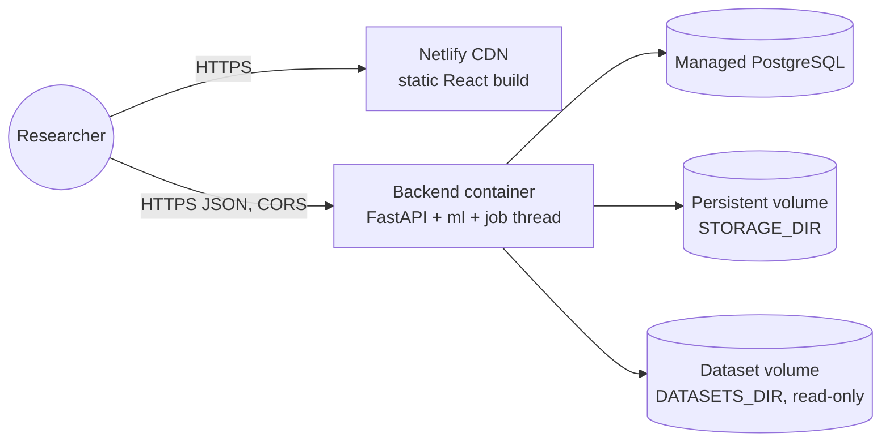
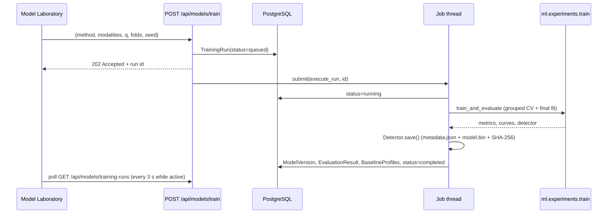

# MOSAIC architecture

## Components

| Layer | Technology | Responsibility |
|---|---|---|
| Frontend | React 18, Vite 5, TypeScript (strict), Tailwind 3, Recharts 2, React Router 6 | 8 pages; reads everything from the API; honest empty, loading and error states |
| API | FastAPI, Pydantic v2, Uvicorn | Validation, error envelope, CORS, OpenAPI docs, pagination |
| Jobs | In-process single worker thread; subprocess for the experiment suite | Ingestion and training without blocking requests |
| Research code | `ml/` (NumPy, pandas, SciPy, scikit-learn, PyTorch, matplotlib) | Ingestion → QC → filters → features → normalisation → detectors → evaluation → explanations |
| Database | PostgreSQL 16 (SQLite for local development and tests), SQLAlchemy 2, Alembic | Metadata, provenance, versions, metrics, baselines, anomaly events, reports |
| File storage | `STORAGE_DIR` (Docker volume) | `processed/dataset_<id>/` (Parquet features, 1 Hz signals, manifest), `artifacts/`, `detections/`, `reports/` |

## Deployment view



## Entity-relationship diagram

```mermaid
erDiagram
  datasets ||--o{ dataset_files : contains
  datasets ||--o{ participants : has
  participants ||--o{ recording_sessions : records
  datasets ||--o{ training_runs : trains
  training_runs ||--o| model_versions : produces
  model_versions ||--o{ evaluation_results : evaluated_by
  model_versions ||--o{ baseline_profiles : stores
  participants ||--o{ baseline_profiles : has
  model_versions ||--o{ detection_runs : used_in
  recording_sessions ||--o{ detection_runs : analysed_in
  detection_runs ||--o{ anomaly_events : flags
  datasets ||--o{ research_reports : summarised_in

  datasets { int id PK; string name; string version; string doi; string status; json manifest; json feature_config }
  dataset_files { int id PK; int dataset_id FK; string relative_path; int bytes; string sha256 }
  participants { int id PK; int dataset_id FK; string pseudonym; string protocol_version }
  recording_sessions { int id PK; string session_key; string protocol; float duration_s; string quality_status; bool excluded; json quality; json phases }
  training_runs { int id PK; string method; string status; json config; json features; datetime started_at; datetime finished_at }
  model_versions { int id PK; string method; int version; string artifact_path; string feature_hash; float threshold; int seed }
  evaluation_results { int id PK; string kind; json metrics; json curves; json per_participant }
  baseline_profiles { int id PK; string status; int n_windows; float period_start_s; float period_end_s; json center; json scale }
  detection_runs { int id PK; float threshold; int n_flagged; string result_path; string mode }
  anomaly_events { int id PK; int window_index; float score; float threshold; string phase; json contributions }
  research_reports { int id PK; string title; string file_path; string sha256 }
```

Constraints and indexes:

* unique `(dataset_id, pseudonym)`, `(dataset_id, session_key)`, `(method, version, dataset_id)` and `(model_version_id, participant_id)`;
* `ON DELETE CASCADE` on child tables;
* indexes on all foreign keys, statuses and `(model_version_id, score)` for anomaly ranking.

## Training sequence



## Key design decisions

1. **One implementation for experiments, the CLI and the API.** `ml.experiments.train.train_and_evaluate` is used by `scripts/train.py`, the API job and the tests, so there is no "demo path".
2. **Normalisation as the personalisation variable.** Every detector consumes z-scored features. Only the reference changes (global / personal / rolling), so personalisation is isolated cleanly.
3. **Missing data.** Missing features become NaN and are treated as zero evidence. A window with no usable feature is unscored (NaN), never imputed with fake values.
4. **Artifact integrity.** `metadata.json` carries the feature list, its hash, the config, seed, threshold, reference statistics and the SHA-256 of `model.bin`. `Detector.load` refuses corrupted, missing or schema-mismatched artifacts. Pickled sklearn models are only loaded from MOSAIC's own storage; the API never accepts model uploads.
5. **Offline only.** Every detection response carries `mode = offline_retrospective` and a note, and the UI repeats it.
