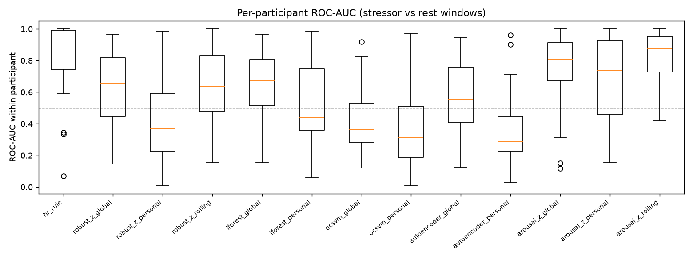
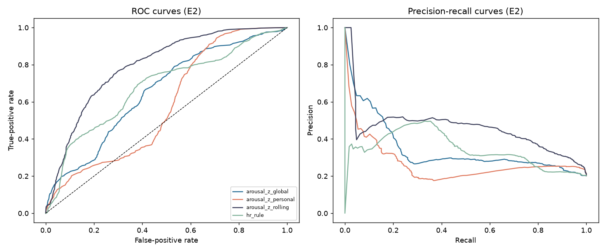
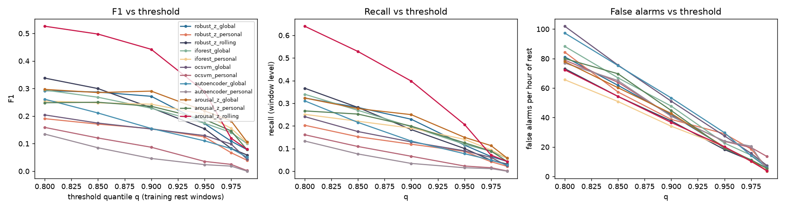

# MOSAIC: Learning and Explanation Guide

A plain-language guide to understanding, explaining and defending the MOSAIC project.

> **How to use this guide.** Part 1 gives you the whole story in two minutes. Parts 2–7 explain every idea step by step, from the sensors to the statistics. Part 8 explains the results and what they mean. Parts 9–12 prepare you for demonstrations, questions and the viva. Every number in this guide comes from the real experiment run `exp_20261015T064235Z`.

---

# Part 1: The project in two minutes

**MOSAIC** stands for *Multimodal Observation System for Anomaly Identification and Clinical Trends*.

**The question.** Smartwatches and research wristbands measure body signals such as heart rate and skin sweat all day. To find "unusual" moments, most systems use one fixed rule for everybody, for example "heart rate above 100 is unusual". But people are different: a resting heart rate of 85 is normal for one person and high for another. So we asked:

> *Does comparing a person with their **own** normal (a personal baseline) detect unusual body signals better than comparing everyone with the **same** population normal?*

**What we built.**

1. A data pipeline that reads real wristband recordings, checks their quality, cleans them and turns them into numbers (features).
2. Detectors that score how unusual each 30-second piece of signal is: statistical z-scores, Isolation Forest, One-Class SVM and a neural-network autoencoder.
3. Each detector in two versions: compared with the population (global) or with the person's own baseline (personal).
4. A fair test that checks which version separates stressful moments from resting moments better.
5. A web application (React frontend + FastAPI backend + database) to explore data, train models, analyse recordings and explain the scores.

**What we found.**

* The simple personal baseline did **not** help; it actually made results worse. The body slowly drifts during a session (for example, skin gets warmer), and relaxation can push values *below* the baseline. Both count as "unusual" even though they are not stress.
* A smarter personal baseline worked best. It keeps updating, using the last 5 minutes, and counts only changes in the "stress direction" (more sweat, faster heart). It reached ROC-AUC 0.80. This version was designed after seeing the first results, so it is reported as exploratory.

**One-sentence summary for your examiner:** *"MOSAIC shows, on real wearable data with a leakage-free evaluation, that personalisation only helps if the personal reference adapts to slow drift and looks at the right direction of change; a fixed personal baseline actually performs worse than a population reference."*

---

# Part 2: The problem and why it matters

## 2.1 What is an "anomaly"?

An anomaly is something that does not fit the usual pattern. In MOSAIC an anomaly means **a period where a person's body signals deviate from their resting state**.

MOSAIC is a **research tool**, not a medical device. It never says "this person is ill". It says "this 30-second window looks different from the reference, by this much, for these reasons".

## 2.2 Why fixed thresholds are a problem

A fixed threshold such as "HR > 100 bpm" treats everyone the same. Two problems follow:

* **Different people, different normals.** Skin conductance (sweat) at rest can differ ten times between people.
* **Thresholds miss small changes.** If your resting HR is 65 and stress raises it to 90, the 100-bpm rule never fires.

Our results confirm this. The HR rule ranks moments almost perfectly *within* each person (median AUC 0.93), but its single cut-off works badly *across* people: it detects only 7.6% of stress windows.

## 2.3 The idea of personalisation

Personalisation means building a **personal baseline**: what *this* person looks like at rest. New data is compared with that baseline instead of with everybody. This sounds obviously better, but it carries risks:

* there is little personal data, so the baseline may be noisy;
* the body changes over time (drift), so an old baseline becomes outdated.

This project measures these trade-offs honestly instead of assuming personalisation wins.

---

# Part 3: The data

## 3.1 The dataset

We used a real, public dataset from **PhysioNet**, a well-known open archive of medical research data:

* **Name:** Wearable Device Dataset from Induced Stress and Structured Exercise Sessions, version 1.0.1
* **Authors:** Hongn, Bosch, Prado and Bonomini (2025)
* **DOI:** 10.13026/he0v-tf17
* **License:** Open Data Commons Attribution (free to use with citation)
* **Device:** Empatica E4 wristband, worn on the non-dominant wrist
* **People:** 36 healthy volunteers aged 18–30, plus exercise sessions

We downloaded all 708 files and checked every file against the official SHA-256 checksums, which prove the files were not damaged or changed.

## 3.2 The sensors (modalities)

| Sensor | What it measures | Rate | Unit | Why it matters for stress |
|---|---|---|---|---|
| EDA (electrodermal activity) | Sweat on the skin, as electrical conductance | 4 per second | µS (microsiemens) | Sweat glands are controlled by the stress (sympathetic) nervous system |
| HR (heart rate) | Beats per minute, computed by the device | 1 per second | bpm | Heart speeds up under stress |
| BVP (blood volume pulse) | Light-based pulse wave | 64 per second | arbitrary units | Pulse strength drops when blood vessels narrow |
| TEMP (skin temperature) | Temperature at the wrist | 4 per second | °C | Hands can cool under stress |
| ACC (accelerometer) | Movement in 3 directions | 32 per second | 1/64 g | Tells us whether the person was moving |

Each sensor runs at a different speed. The pipeline handles this by placing all signals on one shared time axis.

## 3.3 The experiment the volunteers did (our "labels")

Each volunteer did a **stress protocol** while wearing the band. They pressed a button on the wristband to mark the start and end of each part. The protocol:

* a **3-minute baseline** (sitting quietly);
* **stress tasks**: the Stroop colour–word test, mental arithmetic with an annoying sound (TMCT), arguing for and against an opinion, and counting backwards in 13s;
* **rest periods** between tasks.

We used these marks to label each moment:

* **label 1 (stressor):** the window is inside a stress task;
* **label 0 (rest):** the window is inside a rest period;
* no label: transitions, pauses and anything unclear.

**Important honesty point:** these labels say what the person was *asked to do*, not what their body *actually did*. Some people may not feel stressed by a task. That is why we call them **proxy labels**, not true "anomaly labels". The report and the app say this everywhere.

## 3.4 Data problems we found and handled

The dataset's own notes list known problems, and MOSAIC handles each one:

* **S02:** part of the recording is duplicated, so the session is excluded from modelling.
* **f07:** a protective cover blocked the pulse and temperature sensors, so those sensors are marked invalid. The participant became ineligible because no complete baseline was available.
* **f14:** the recording is split into two files, so it is excluded.

General problems handled automatically:

* missing values;
* impossible values (for example skin temperature below 20 °C);
* "flat-line" signals (a disconnected sensor repeating one value);
* duplicate timestamps;
* different sampling rates;
* gaps in uploaded files.

After this, **33 participants** were eligible, giving **3,903 evaluation windows**: 789 stressor windows and 3,114 rest windows.

---

# Part 4: The pipeline, step by step

Think of the pipeline as a factory line. Raw files go in; scores and explanations come out.

```diagram dataflow
```

## Step 1: Reading the files

Each Empatica file starts with two header lines: the start time and the sampling rate. Then come the values. MOSAIC reads these, checks they make sense (a sampling rate must be positive and realistic, a timestamp must be valid) and reports any broken rows instead of crashing.

## Step 2: Quality checks

For every sensor we compute:

* the missing fraction;
* the out-of-range fraction;
* the flat-line fraction.

Each recording is then marked **good**, **degraded** or **unusable**. In the real data, 92 sessions were good and 8 degraded.

## Step 3: Cleaning (filtering)

Each sensor is cleaned differently, because each has different noise:

* **EDA:** a low-pass filter at 1 Hz removes fast electrical noise but keeps real sweat responses.
* **BVP:** a band-pass filter at 0.5–8 Hz keeps the heartbeat and removes slow drift and fast noise.
* **TEMP and HR:** a 5-second median filter removes sudden spikes.
* **ACC:** the three directions are combined into one movement strength, √(x² + y² + z²), then smoothed.

## Step 4: Cutting into windows

The long recording is cut into **30-second windows**, starting every **10 seconds**, so windows overlap. Why 30 seconds? Some stress tasks last only about 30 seconds, and a longer window would never fit inside them.

A window is used for a sensor only if **at least 80%** of its samples are valid. Otherwise that sensor's features are left empty for that window, and nothing is invented.

## Step 5: Features (turning a window into numbers)

Each window becomes **14 numbers**:

| Feature | Plain meaning |
|---|---|
| eda_mean, eda_std | Average sweat level and how much it varies |
| eda_slope | Is sweat rising or falling? |
| eda_scr_rate | Number of small sweat "bursts" per minute |
| hr_mean, hr_std, hr_slope | Average heart rate, its variation and its trend |
| temp_mean, temp_slope | Average skin temperature and its trend |
| bvp_amp | Strength of the pulse wave |
| bvp_rate | Pulse rate estimated from the pulse wave |
| acc_mean, acc_std | Average movement and how jerky it is |
| eda_hr_corr | Do sweat and heart rate move together? |

These features are **interpretable**: a person can understand each one, so explanations make sense.

## Step 6: The reference (global vs personal vs rolling)

This is the **heart of the research question**. Before scoring, every feature is converted into a **z-score**: *how many "typical steps" away from the reference is this value?*

* **Global reference:** the typical value and spread of all *training* participants at rest.
* **Personal reference:** the typical value and spread of *this* participant during the last 5 minutes before their first stress task.
* **Rolling reference:** the typical value of *this* participant in the 5 minutes just before the current window. It keeps moving forward in time.

All detectors use the same z-scores. The only thing that changes between "global" and "personal" is the reference, so any difference in results is caused by personalisation itself.

## Step 7: Scoring with detectors

Each detector reads the z-scores of a window and outputs an **anomaly score**: higher means more unusual. The detectors are explained in Part 5.

## Step 8: Threshold, then flag

A score becomes a yes/no flag by comparing it with a **threshold**. We set the threshold so that only 5% of *training* participants' rest windows would be flagged: the 95th percentile. On new participants the real false-alarm rate came out between 3.7% and 8.3%, close to the 5% target.

## Step 9: Explanation

For any window, MOSAIC shows which features pushed the score up, compared with the reference, together with the data quality and limitations.

---

# Part 5: The models explained simply

## 5.1 Robust z-score (statistical baseline)

**Idea:** measure how far each feature is from normal, then combine the distances.

For one feature:

$$z = \frac{x - \text{median}}{1.4826 \times \text{MAD}}$$

* The **median** is the middle value. It is used instead of the average because a few extreme values cannot move it much.
* The **MAD** (median absolute deviation) is the typical distance from the median, a robust version of the standard deviation. Multiplying by 1.4826 makes it comparable to the standard deviation for normal data.
* The score of a window is the root-mean-square of all 14 z-scores: big when several features are far from normal.

**Strength:** simple, fast and fully explainable. **Weakness:** treats features separately and counts *any* deviation, up or down.

## 5.2 Arousal-directed z-score (the post-hoc variant)

The same as above, but **one-sided**: it counts only changes in the direction stress is expected to push the body (sweat ↑, heart rate ↑, pulse rate ↑, pulse strength ↓, skin temperature ↓). A drop in heart rate during relaxation no longer counts as "unusual".

## 5.3 Isolation Forest

**Idea:** unusual points are easy to separate from the rest.

The forest builds many random trees. Each tree repeatedly picks a random feature and a random cut point, splitting the data. A normal point sits in a dense crowd and needs many cuts to be isolated; an unusual point is isolated after only a few cuts. **Short average path length → high anomaly score.** We used 200 trees.

## 5.4 One-Class SVM

**Idea:** draw a boundary around "normal" data; points outside the boundary are anomalies.

It uses a "kernel" (a mathematical trick) so that the boundary can be curved. The parameter ν (nu, 0.05) controls roughly what fraction of training points may fall outside. **Weakness:** slow on large data, and in our data the boundary did not line up with stress.

## 5.5 Autoencoder (neural network, PyTorch)

**Idea:** train a network to copy its input through a narrow "bottleneck". It learns to rebuild *normal* windows well; unusual windows are rebuilt badly.

Architecture: 14 → 16 → 4 → 16 → 14. The **reconstruction error** (how badly the window was rebuilt) is the anomaly score. Training stops early when a separate validation group stops improving (early stopping).

**Why no LSTM/GRU?** Each person has only about 5 minutes of baseline. That is far too little sequence data to train a time-series network properly, so a simpler model is the honest choice.

## 5.6 The fixed HR rule

The conventional rule "heart rate > 100 bpm", used as a reference point: the "global threshold" the project wanted to compare against.

---

# Part 6: Fair testing (evaluation) explained

## 6.1 Why fairness matters: data leakage

**Leakage** means the test accidentally sees information it should not have, which makes results look better than they really are. Two kinds matter here:

* **Participant leakage:** if windows from the same person are in both training and testing, the model partly "recognises the person". **Fix:** whole people are put in either training or testing, never both.
* **Temporal leakage:** if the personal baseline used data from *after* the moment being tested, it would be using the future. **Fix:** the baseline uses only the 5 minutes *before* the first stress task, and testing starts *after* it.

Both rules are checked by automated tests.

## 6.2 Cross-validation

We split the 33 participants into **5 groups (folds)**. Each round, 4 groups train and 1 group tests; this repeats 5 times so everyone is tested exactly once. All methods are tested on **exactly the same windows**, so the comparison is fair.

## 6.3 The metrics in plain words

| Metric | Plain meaning | Chance level |
|---|---|---|
| ROC-AUC | If you pick one stress window and one rest window at random, the probability that the stress window gets the higher score | 0.5 |
| PR-AUC | How well the method finds stress windows while keeping false alarms low; useful when stress windows are the minority | 0.20 (stress share) |
| Per-participant AUC | ROC-AUC computed inside each person, then the median: "does it rank moments correctly *for each individual*?" | 0.5 |
| Precision | Of the windows flagged, how many really were stress | n/a |
| Recall | Of the stress windows, how many were flagged | n/a |
| F1 | Balance of precision and recall | n/a |
| False alarms per hour | How many rest windows per hour of rest were wrongly flagged | n/a |
| Event sensitivity | Fraction of stress tasks with at least one flagged window | n/a |

## 6.4 Uncertainty: confidence intervals and tests

* **Bootstrap 95% confidence interval:** we resampled *participants* 1,000 times and recomputed the result each time. The middle 95% of those results is the interval. Resampling people rather than windows respects the fact that one person's windows are related.
* **Wilcoxon signed-rank test:** compares two methods person by person. A small p-value (below 0.05, or below 0.00625 after correcting for 8 comparisons) means the difference is unlikely to be luck.

---

# Part 7: The software system

## 7.1 Architecture

```diagram architecture
```

* **Frontend (what users see):** React + TypeScript + Tailwind CSS + Recharts charts, with 8 pages.
* **Backend (the server):** FastAPI (Python). It checks every request, runs the ML code and returns JSON.
* **Database:** PostgreSQL in production (SQLite on a laptop). It stores datasets, participants, sessions, training runs, model versions, metrics, baselines, anomalies and reports.
* **Files:** processed features (Parquet format), model files and reports. Big raw signals stay in files because putting about 100 million samples in a database would be slow and pointless.
* **Background jobs:** training and data processing run in the background, so the website stays responsive.

## 7.2 The eight pages

| Page | What it does | What to show in a demo |
|---|---|---|
| Dashboard | Dataset status, quality, models, recent anomalies | "Everything here comes from the backend; nothing is fake." |
| Data Explorer | Import data, view signals with stress/rest shading, quality tables | Pick S05 and show EDA and HR rising during tasks |
| Anomaly Monitoring | Score a whole recording with a model; timeline with threshold | Run *Arousal z · rolling* on STRESS_S05 |
| Personal Baselines | Each person's baseline period, statistics and deviation over time | Show the baseline period and the "insufficient history" warnings |
| Model Laboratory | Train models, see metrics, ROC/PR curves, compare methods | Train a model live; show the comparison table |
| Explainability | Why a window was flagged: feature contributions, value vs reference | Click a flagged point; show the top contributing features |
| Research Reports | Generate and download a report with all results and figures | Generate a report |
| Project Information | Objectives, method, dataset, safety statement | Point to the safety statement |

## 7.3 Safety and honesty features (good to mention)

* No fake data: with no dataset, the app shows an empty state with instructions.
* With no trained model, detection returns a clear "model not ready" error instead of a guess.
* Every model file has a checksum; a damaged file is refused, never silently replaced.
* The app labels everything "offline research analysis", and scores are "not probabilities".
* Security: protection against path tricks (`../`), file-size and file-type limits, zip-bomb and zip-slip checks, input validation, and a strict list of allowed websites (CORS).
* **93 automated tests** check all of this; all pass.

---

# Part 8: The results, explained

## 8.1 Main comparison (planned in advance)

| Method | ROC-AUC [95% CI] | Median per-person AUC |
|---|---|---|
| HR > 100 rule | 0.680 [0.613, 0.765] | 0.930 |
| Robust z, global | 0.587 [0.535, 0.639] | 0.654 |
| Robust z, personal | 0.420 [0.329, 0.513] | 0.367 |
| Robust z, rolling | 0.648 [0.569, 0.720] | 0.635 |
| Isolation Forest, global | 0.598 [0.548, 0.654] | 0.672 |
| Isolation Forest, personal | 0.513 [0.417, 0.604] | 0.439 |
| One-Class SVM, global | 0.424 [0.368, 0.478] | 0.363 |
| One-Class SVM, personal | 0.370 [0.288, 0.457] | 0.313 |
| Autoencoder, global | 0.576 [0.509, 0.642] | 0.556 |
| Autoencoder, personal | 0.357 [0.278, 0.445] | 0.288 |

**How to read it:** 0.5 means guessing. Personal versions are lower than global ones for every model family. For the robust z-score (p = 0.0005) and the autoencoder (p = 0.0002) the drop is statistically clear.



## 8.2 Why did personalisation hurt? (the key insight)

Three things happen during a session:

1. **Skin temperature drifts upward.** By the rest periods, which come later, temperature is far above the early baseline. Temperature alone gave a personal AUC of 0.24, much *worse* than guessing.
2. **Relaxation goes below baseline.** During rest, heart rate drops *below* the baseline. A two-sided score treats "below" as unusual too.
3. **The personal "spread" is narrow.** A person's 5-minute baseline varies only a little, so even small drifts produce large z-scores.

Evidence: removing temperature raised the robust-z personal per-person AUC from 0.37 to 0.56.

## 8.3 What worked best (exploratory)

| Method | ROC-AUC [95% CI] | Median per-person AUC |
|---|---|---|
| Arousal z, global | 0.656 [0.593, 0.724] | 0.810 |
| Arousal z, personal | 0.583 [0.501, 0.681] | 0.737 |
| **Arousal z, rolling** | **0.796 [0.745, 0.846]** | **0.875** |

Counting only the stress direction removes the relaxation problem, and the rolling baseline removes the drift problem. Together they give the best result. **But** this method was invented *after* looking at the first results, so it must be confirmed on new data before anyone can claim it works. Saying this openly is good scientific practice.



## 8.4 Other findings

* **Which sensor matters most?** Heart rate. Using heart rate alone, personal and global perform equally. Skin temperature hurts personal methods, and movement alone is at chance level.
* **Longer baselines?** Using 1 to 5 minutes of baseline did not steadily improve results. The problem is drift, not the amount of data.
* **Sensor failure:** if one sensor stops after the baseline, the system keeps working. Losing the pulse sensor hurts most.
* **Agreement with how people felt:** the HR rule and the rolling arousal method matched self-reported stress best (within-person correlation ρ ≈ 0.62–0.63).
* **Speed:** every model trains in seconds and scores a window in under 2 ms.
* **Honest limitation:** even the best method raises about 20 false alarms per hour of rest. It is a research result, not a ready monitoring product.



---

# Part 9: Demonstration script (about 5 minutes)

1. **Dashboard (30 s):** "This is MOSAIC. 36 participants, 20,654 windows, 5 sensors, all from the real PhysioNet dataset, and nothing is simulated."
2. **Data Explorer (1 min):** choose participant S05 and session STRESS_S05. "Orange areas are stress tasks, blue areas are rest. Watch EDA and heart rate rise during the tasks. The dashed line is the end of the personal baseline."
3. **Model Laboratory (1 min):** show the comparison table. "Personal versions scored lower than global ones; this is our main and honest finding."
4. **Anomaly Monitoring (1 min):** choose *Arousal z · rolling*, S05, *Run offline analysis*. "Each dot is a 30-second window; red dots are above the threshold."
5. **Explainability (1 min):** click a red dot. "Here are the features that pushed the score up, compared with the person's recent baseline. This shows association, not cause."
6. **Reports (30 s):** generate and download the report.

**Before the demo:** start the backend and the frontend; see Part 12.

---

# Part 10: How to explain it at different lengths

**30 seconds:** "MOSAIC tests whether comparing people with their own normal body signals detects stress-like changes better than population thresholds. On real wristband data, a simple personal baseline did worse because of slow drift, but an adaptive, direction-aware personal baseline did best. We built a full web platform around it."

**2 minutes:** Part 1 of this guide.

**10 minutes:** problem (Part 2) → data and labels (Part 3) → pipeline (Part 4) → models (Part 5) → fair testing (Part 6) → results and why (Part 8) → limitations (Part 11) → demo (Part 9).

---

# Part 11: Limitations (say these before you are asked)

* The labels are experimental phases, not medical ground truth.
* There are only 33 healthy young adults, recorded in a laboratory with one device, so the results may not hold for patients or daily life.
* The best method was found after seeing the data and needs confirmation on another dataset (for example WESAD).
* The baseline is only 5 minutes long; there is no multi-day history.
* The system analyses recordings afterwards (offline); it does not do real-time monitoring.
* The false-alarm rate is still too high for practical use.

---

# Part 12: Running and deploying

**On your laptop:** you need two terminals, one for the backend and one for the frontend. Both must stay open.

```
python -m uvicorn app.main:app --app-dir backend --port 8000
npm --prefix frontend run dev
```

Then open http://localhost:5173. The interactive API documentation is at http://localhost:8000/docs.

**Run the tests:** `python -m pytest` (93 tests).

**Online:** the website (frontend) is hosted on Netlify at https://mosaicappn.netlify.app. Netlify can only host static pages, so the Python backend must run somewhere else:

* **Temporary:** run the backend on your laptop plus a Cloudflare quick tunnel, which gives a public `https://….trycloudflare.com` address. Put that address in Netlify's `VITE_API_BASE_URL` setting and redeploy. This works only while your laptop runs, and the address changes on every restart.
* **Permanent (recommended):** a free Hugging Face Docker Space using the files in `deploy/huggingface/`. It downloads the data and trains the models automatically on start-up. See `docs/deployment.md`.

---

# Part 13: Glossary

| Term | Meaning |
|---|---|
| Anomaly | Something that differs from the usual pattern |
| Baseline | A reference "normal" state |
| Personal baseline | A baseline built from one person's own data |
| Drift | Slow change of a signal over time that is unrelated to the event of interest |
| Feature | A number computed from a signal window (for example mean heart rate) |
| Window | A short piece of signal (30 s here) |
| z-score | How many typical steps a value is from the reference |
| Median / MAD | Robust middle value and robust spread |
| Threshold | The cut-off above which a window is flagged |
| Data leakage | When the test accidentally sees information it should not have |
| Cross-validation | Repeatedly splitting the data into train and test parts |
| ROC-AUC | Probability that a stress window outranks a rest window |
| Bootstrap | Repeated resampling to estimate uncertainty |
| p-value | How surprising a result would be if there were no real difference |
| Post hoc | Decided after seeing the results (so it needs confirmation) |
| Proxy label | An indirect label (stress task vs rest) rather than true ground truth |
| CORS | A browser security rule listing which websites may call the backend |
| API | The set of URLs the frontend uses to talk to the backend |

---

# Part 14: Twenty likely viva questions with short answers

1. **What is your research question?** Whether personal baselines detect physiological anomalies better than global thresholds and non-personalised ML.
2. **Which dataset did you use, and why?** The PhysioNet wearable stress dataset: it is real, open, multimodal, and has protocol labels.
3. **What counts as an anomaly here?** A window that deviates from the resting state; we evaluate it with stressor vs rest phases.
4. **Why are your labels "proxies"?** They mark the task given, not the body's actual response.
5. **Why 30-second windows?** The short stress tasks last about 30 seconds, so longer windows would never fit inside them.
6. **Why the median and MAD?** They are robust to artefacts; the mean and SD are not.
7. **How is the personal baseline built?** From the last 5 minutes before the first stress task: the median, plus a spread pulled towards a typical value (shrinkage).
8. **How did you prevent leakage?** By splitting people (not windows), fitting everything only on training people, and using only the past for the baseline.
9. **Explain Isolation Forest.** Random splits isolate unusual points faster; a short path means a high score.
10. **Explain the autoencoder.** It learns to rebuild normal windows; the reconstruction error is the score.
11. **Why no LSTM?** There is too little per-person sequence data to justify it.
12. **How did you choose the threshold?** The 95th percentile of training people's rest-window scores, targeting 5% false alarms.
13. **What is ROC-AUC?** The chance that a random stress window scores above a random rest window.
14. **Was your hypothesis supported?** No, not for fixed personal baselines; they were significantly worse for robust z and the autoencoder.
15. **Why?** Temperature drift and relaxation below baseline, made larger by the narrow personal spread.
16. **What worked best?** The rolling, arousal-directed personal score (AUC 0.80). It is exploratory.
17. **Which sensor is most useful?** Heart rate.
18. **Can it be used clinically?** No. It is research software with proxy labels and too many false alarms.
19. **How do explanations work?** Feature contributions (squared z or reconstruction error, or occlusion); they show association, not cause.
20. **What would you do next?** Confirm the result on another dataset, use drift-aware baselines, suppress motion artefacts and add HRV features.

The full set of 42 questions with model answers is in `docs/viva.md`.
