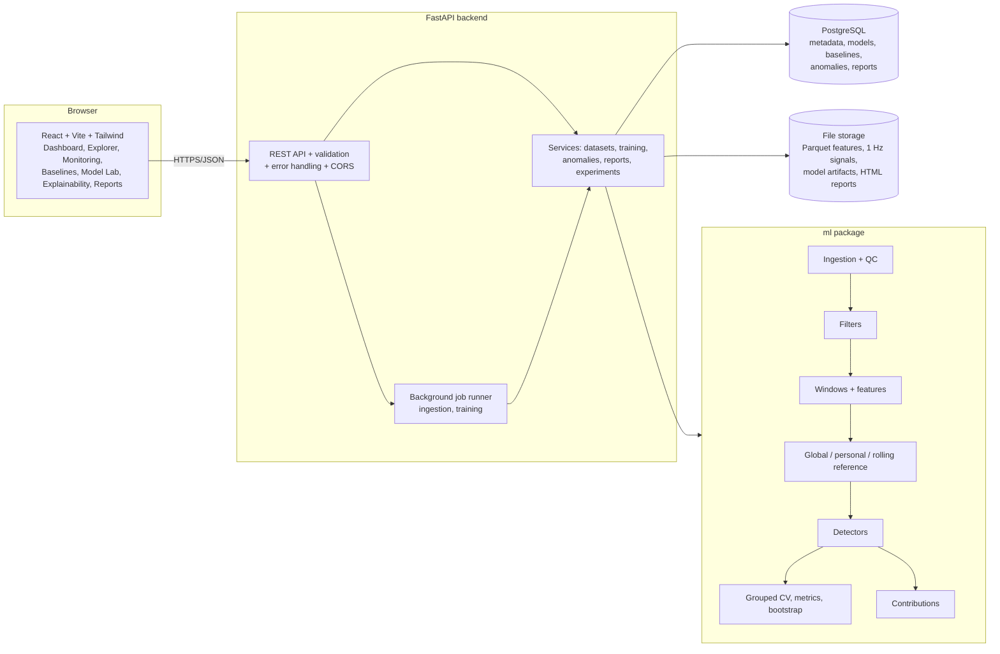
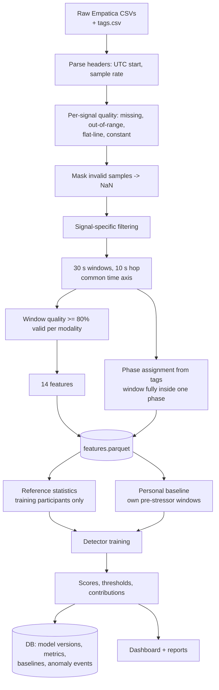
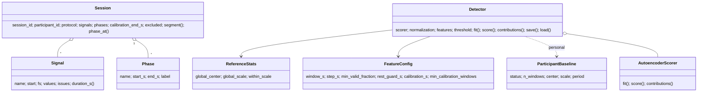
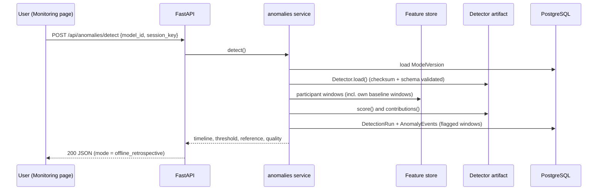

# MOSAIC: Multimodal Observation System for Anomaly Identification and Clinical Trends

### Personalised versus global anomaly detection in multimodal wearable physiological signals

**A major project report submitted in partial fulfilment of the requirements for the degree of Bachelor of Technology in Computer Science and Engineering (Data Science)**

| | |
|---|---|
| Student | *[Name, Roll number]* |
| Supervisor | *[Name, Designation]* |
| Department | Computer Science and Engineering (Data Science) |
| Institution | *[Institution name]* |
| Academic year | *[2025–2026]* |

> Fields in *[brackets]* must be completed by the student. All numerical results in this report were produced by the code in this repository, in experiment run `exp_20261015T064235Z` (`reports/experiments/main/results.json`). Re-running the pipeline regenerates them (see §30).

---

## Abstract

Wearable devices continuously record physiological signals such as electrodermal activity (EDA), heart rate (HR), blood volume pulse (BVP), skin temperature (TEMP) and acceleration (ACC). Fixed population thresholds ignore large differences between individuals. This project asks: *does personalised baseline modelling improve physiological anomaly detection compared with global statistical thresholds and non-personalised machine-learning methods?*

We built MOSAIC, an integrated system with a data-ingestion and quality-control pipeline, signal-specific preprocessing, 14 interpretable window features, four detector families (robust z-score, Isolation Forest, One-Class SVM and a PyTorch autoencoder), and three normalisation references:

* **global**: population median and scale,
* **personal**: each participant's own 5-minute pre-stressor baseline,
* **rolling**: the participant's preceding 5 minutes.

The system also includes a FastAPI/PostgreSQL backend and a React dashboard. Using the open PhysioNet *Wearable Device Dataset from Induced Stress and Structured Exercise Sessions* (Empatica E4), we operationalised "anomaly" as deviation from a resting state. We evaluated detectors against protocol phases (stressor tasks vs rest) with 5-fold participant-grouped cross-validation on 33 participants (3,903 windows).

The pre-declared primary analysis **did not support the hypothesis**. With a fixed personal baseline, two-sided detectors performed worse than their global counterparts; for example, robust z ROC-AUC fell from 0.587 to 0.420 (paired difference −0.167, 95% CI [−0.243, −0.090]). Diagnostics traced this to within-session drift and to relaxation below baseline, which two-sided scores also treat as anomalous. Skin temperature alone produced a personal AUC of 0.24.

A post-hoc secondary analysis used an adaptive rolling personal baseline with one-sided, arousal-directed scoring and achieved ROC-AUC 0.796 [0.745, 0.846]. Because it was defined after seeing the primary results, it is exploratory. A fixed "HR > 100 bpm" rule ranked windows well within participants (median per-participant AUC 0.93) but poorly across participants (pooled AUC 0.68).

The results show that how "normal" is defined, both its temporal reference and the direction of deviation, matters more than personalisation alone. MOSAIC is research software and makes no clinical claims.

**Keywords:** wearable sensors, anomaly detection, personalisation, robust statistics, Isolation Forest, One-Class SVM, autoencoder, leakage-free evaluation, explainability.

---

## 1. Introduction

Consumer and research wearables such as the Empatica E4 record several physiological channels continuously. Turning these streams into useful information requires identifying periods that are *unusual*. What is unusual differs between people: resting skin conductance can differ by an order of magnitude between individuals (Boucsein, 2012), and resting heart rate varies widely. Population thresholds such as "HR > 100 bpm" are simple and interpretable but ignore this variability. Person-specific models are intuitively attractive but need enough person-specific history, and they can be fragile when physiology drifts.

MOSAIC is a complete, reproducible platform for investigating this trade-off on real data, with a working web application on top of the research pipeline.

## 2. Problem statement

Given multimodal wearable recordings from many individuals, detect time windows whose physiology deviates from the individual's resting state, and determine empirically whether participant-specific (personalised) references detect such deviations better than global references and non-personalised ML. The evaluation must avoid leakage across participants and across time, and it must report uncertainty.

## 3. Motivation

* **Inter-individual variability.** A fixed threshold calibrated on a population is too sensitive for some people and too insensitive for others.
* **Trustworthy evaluation.** Many wearable-ML studies mix windows of the same person across training and test sets, which inflates results (Saeb et al., 2017). A leakage-free design is itself a contribution to good practice.
* **Interpretability.** Users of research dashboards need to know *which* signals drove a score and what the score does *not* mean.
* **Engineering.** A research result is more useful when it is reproducible and accessible through an application.

## 4. Objectives

1. Build a reliable physiological time-series ingestion pipeline with data-quality checks.
2. Compare interpretable statistical anomaly detection with machine learning.
3. Investigate participant-specific baselines.
4. Evaluate without participant leakage or temporal leakage.
5. Investigate the contribution of each physiological modality.
6. Implement interpretable anomaly visualisations and explanations.
7. Build a functional web application connected to the real pipeline.
8. Produce reproducible experiments and documentation.

All eight objectives were implemented. Their outcomes are reported in §20.

## 5. Scope

**In scope:** offline (retrospective) analysis of recorded sessions; the PhysioNet dataset above and generic CSV uploads; window-level detection; protocol-phase evaluation; a research dashboard.

**Out of scope:** real-time streaming, clinical diagnosis, event prediction, regulatory compliance, and generalisation claims beyond healthy young adults in a laboratory protocol.

## 6. Literature review

*This is a focused review of the work that directly informs the design. It is not a systematic review, so no novelty claim is made.*

**Wearable stress and affect datasets.** WESAD (Schmidt et al., 2018) established a public multimodal benchmark (chest and wrist devices) for stress and affect detection. It popularised the leave-one-subject-out evaluation and the Empatica wrist modalities used here. Surveys of stress detection in daily life (Can, Arnrich & Ersoy, 2019) highlight inter-individual variability, motion artefacts and the gap between laboratory and free-living performance. Sano & Picard (2013) combined wearable sensors with phone data to recognise stress. The dataset used here (Hongn et al., 2025a, 2025b) adds structured exercise sessions and a stress protocol inspired by classic laboratory stressors: the Stroop test (Stroop, 1935) and Trier-style mental-arithmetic tasks (Kirschbaum et al., 1993).

**Anomaly detection.** Chandola, Banerjee & Kumar (2009) survey anomaly detection and distinguish point, contextual and collective anomalies. Isolation Forest (Liu, Ting & Zhou, 2008) isolates anomalies with random axis-aligned partitions. The One-Class SVM (Schölkopf et al., 2001) estimates the support of the normal distribution in a kernel feature space. Autoencoders detect anomalies through reconstruction error (e.g. Sakurada & Yairi, 2014).

**Robust statistics.** The median absolute deviation (MAD) is a robust scale estimator with a 50% breakdown point (Rousseeuw & Croux, 1993). Leys et al. (2013) recommend MAD-based outlier rules over mean ± SD.

**Evaluation pitfalls.** Saeb et al. (2017) showed that record-wise cross-validation can drastically overestimate the performance of subject-level clinical predictions. Kaufman et al. (2012) formalised data leakage. For imbalanced problems, precision-recall analysis is more informative than ROC analysis alone (Saito & Rehmsmeier, 2015).

**Explainability.** SHAP (Lundberg & Lee, 2017) provides model-agnostic attributions. For our models, simpler exact decompositions (z-score and reconstruction-error contributions) or occlusion are available, cheaper and easier to interpret, so SHAP was not needed (§18.6).

## 7. Research gap

Within the limited review above we did **not** find a study that compares, on this specific dataset and under one leakage-free protocol, the same detector families with *global*, *fixed personal* and *rolling personal* references, including ablations of modality, calibration length and sensor drop-out. We describe this as a *gap in the literature we examined*, not a claim that no such work exists. A systematic search (e.g. PubMed/IEEE Xplore with PRISMA reporting) would be needed before claiming novelty.

## 8. Proposed methodology (overview)

1. **Data:** PhysioNet wearable dataset, STRESS protocol for evaluation; exercise protocols are ingested for exploration only.
2. **Labels:** protocol phases recovered from button tags. Stressor tasks = 1, rest phases = 0 (§14).
3. **Preprocessing:** plausibility and flat-line masking, then signal-specific filters (§16).
4. **Windows and features:** 30 s windows, 10 s hop, 14 features (§17).
5. **References:** global, personal (last 5 min before the first stressor), rolling (preceding 5 min) (§18.1).
6. **Detectors:** robust z, Isolation Forest, One-Class SVM, autoencoder, plus a fixed HR rule (§18).
7. **Evaluation:** 5-fold participant-grouped CV. Models are trained on training participants' baseline windows only, and thresholds are set from training participants' rest windows. Metrics come with participant-level bootstrap CIs and paired Wilcoxon tests (§19).
8. **Ablations and robustness:** modality, calibration length, threshold, sensor drop-out, computational cost, agreement with self-report.

A temporal neural network (LSTM/GRU) was considered and **not** implemented. Each participant contributes only ~5 minutes (~27 overlapping windows) of baseline data, and the evaluation phases are only a few minutes long, which is too little independent sequence data to justify a sequence model. Simpler models were preferred, as the project brief requires.

## 9. System architecture

Design decisions:

* **Separation of the research code (`ml/`) from the web service (`backend/`).** The same functions run in experiments, CLI scripts, tests and API jobs, which guarantees that training and inference share one implementation.
* **Metadata in PostgreSQL, signals in files.** High-frequency samples (about 247 MB raw) are stored as Parquet window features and 1 Hz summaries. Inserting about 10⁸ raw samples into a relational table would add cost without analytical benefit.
* **Background jobs** run ingestion and training in a worker thread, with their status persisted in the database. The full experiment suite runs as a separate OS process. A task queue (Celery/RQ) is the documented upgrade path.

More diagrams (data flow, UML class and sequence diagrams, ER diagram) are in [docs/architecture.md](architecture.md).

## 10. Data-flow diagram

## 11. UML diagrams

Class structure of the core ML abstractions:

Sequence of an offline detection request:

## 12. Dataset description

| Property | Value (verified from the downloaded release) |
|---|---|
| Dataset | Wearable Device Dataset from Induced Stress and Structured Exercise Sessions, v1.0.1 |
| Source / license | PhysioNet, DOI 10.13026/he0v-tf17, ODC-By 1.0, open access |
| Device | Empatica E4, non-dominant wrist |
| Modalities | EDA 4 Hz (µS), BVP 64 Hz, HR 1 Hz (bpm, derived from BVP), TEMP 4 Hz (°C), ACC 32 Hz (1/64 g), IBI |
| Sessions found | STRESS 37 folders (36 participants), AEROBIC 31, ANAEROBIC 32 |
| Participants | healthy volunteers aged 18–30; first stage `S01–S18` (protocol V1), second stage `f01–f18` (V2) |
| Annotations | button tags (`tags.csv`) at protocol-segment boundaries; self-reported stress levels (1–10) per phase |
| Windows generated | 20,654 in total (STRESS 9,215; AEROBIC 6,509; ANAEROBIC 4,930) |

**STRESS protocol phases** (tag indices T0…Tn, following the dataset's notebook):

| Version | Stressor tasks (label 1) | Rest phases (label 0) | Baseline |
|---|---|---|---|
| V1 (13 tags) | Stroop [T2,T3], TMCT [T4,T5], Real Opinion [T6,T7], Opposite Opinion [T8,T9], Subtract [T10,T11] | First Rest [T3,T4], Second Rest [T5,T6] | [T0,T1] |
| V2 (9 tags) | TMCT [T1,T2], Real Opinion [T3,T4], Opposite Opinion [T5,T6], Subtract [T7,T8] | First Rest [T2,T3], Second Rest [T6,T7] | [T0,T1] |

The stressor spans are taken from the dataset notebook. The rest phases follow the phase order of the `Stress_Level_v*.csv` files. The baseline span is *inferred* from that order and from the protocol description (about 3 minutes in V1).

**Why these labels are proxies.** "Stressor task vs rest" is an experimental manipulation, not a ground-truth physiological anomaly. Some participants may not respond, and responses carry over into rest. We therefore use them to answer "does the detector separate perturbed from resting windows?", not to measure diagnostic accuracy.

**Exclusions** (from `data_constraints.txt`):

* S02: duplicated segments.
* f14: split recording, with the baseline in a separate file.
* f07: PPG and temperature blocked by the dock. It is ingested with those modalities marked invalid and is ineligible for the main analysis because it has no complete baseline windows.

This leaves **33 eligible participants**, with 3,903 evaluation windows (789 stressor, 3,114 rest; prevalence 0.202) and 921 baseline windows.

## 13. Mathematical foundations

### 13.1 Robust location, scale and z-scores

For a feature $x$ with reference sample $\{x_i\}$:

$$\tilde{x} = \operatorname{median}(x_i), \qquad \text{MAD} = \operatorname{median}\lvert x_i - \tilde{x}\rvert, \qquad \hat{\sigma} = 1.4826 \cdot \text{MAD}$$

The constant 1.4826 makes $\hat\sigma$ consistent for the standard deviation under normality. The robust z-score is $z = (x - \tilde x)/\hat\sigma$. The median and MAD have a 50% breakdown point, so up to half of the reference windows can be artefacts without breaking the estimate (Rousseeuw & Croux, 1993).

### 13.2 Personal scale shrinkage

A participant's baseline holds only $n \approx 27$ overlapping windows. With window length $w$ and hop $h$, the effective sample size is $n_\text{eff} = n\,h/w$. A near-zero personal MAD would make z-scores explode, so it is shrunk towards the typical within-person scale $s_w$, which is the median of the training participants' personal scales:

$$\hat\sigma_p^2 = \frac{n_\text{eff}\,\hat\sigma_{\text{MAD},p}^2 + k\,s_w^2}{n_\text{eff} + k}, \qquad k = 5$$

This is a simple empirical-Bayes-style compromise between personal and population information.

### 13.3 Scores

Let $\mathbf{z}\in\mathbb{R}^d$ be the normalised feature vector, clipped to $[-20, 20]$. The scores are:

* **Robust z (two-sided):** $s = \sqrt{\tfrac{1}{d}\sum_j z_j^2}$.
* **Arousal-directed z (one-sided, secondary):** $s = \sqrt{\tfrac{1}{|D|}\sum_{j\in D}\max(d_j z_j, 0)^2}$, where $d_j=+1$ for EDA level, EDA variability, EDA slope, SCR rate, HR and pulse rate, and $d_j=-1$ for pulse amplitude and skin temperature (peripheral vasoconstriction).
* **Isolation Forest:** with expected path length $E[h(x)]$ over $t$ random trees and normaliser $c(n) = 2H(n-1) - 2(n-1)/n$, $s(x) = 2^{-E[h(x)]/c(n)}$ (Liu et al., 2008). We use the negated scikit-learn `score_samples`, so higher means more anomalous.
* **One-Class SVM:** this solves $\min_{w,\xi,\rho} \tfrac12\|w\|^2 + \tfrac{1}{\nu n}\sum_i \xi_i - \rho$ s.t. $\langle w,\phi(x_i)\rangle \ge \rho - \xi_i,\ \xi_i\ge 0$ with an RBF kernel $k(x,x') = \exp(-\gamma\|x-x'\|^2)$. The score is $-f(x) = -(\sum_i \alpha_i k(x_i,x) - \rho)$. Here $\nu$ upper-bounds the fraction of training outliers (Schölkopf et al., 2001).
* **Autoencoder:** encoder $g_\theta$ and decoder $f_\phi$, with reconstruction loss $L(\mathbf z) = \tfrac1d \|\mathbf z - f_\phi(g_\theta(\mathbf z))\|_2^2$, minimised with Adam and weight decay. The score is $L(\mathbf z)$.

### 13.4 Threshold selection

The detectors are trained on "normal" data only. The alert threshold is the empirical $q$-quantile ($q=0.95$) of scores on the *training participants'* rest windows: $\tau = Q_q(\{s(x): x\in\text{rest}_\text{train}\})$. This targets a false-positive rate of $1-q$. The realised test FPR (§20) measures how well this calibration transfers to new participants. The fixed rule uses $\tau = 100$ bpm.

### 13.5 Evaluation metrics

With TP, FP, TN and FN counted at threshold $\tau$:

* precision $=TP/(TP+FP)$, recall $=TP/(TP+FN)$, $F_1 = 2PR/(P+R)$, FPR $=FP/(FP+TN)$;
* **ROC-AUC** $= P(s(x^+) > s(x^-))$, the probability that a random stressor window scores higher than a random rest window;
* **PR-AUC** is average precision; its chance level equals the prevalence (0.202);
* **false alarms per hour** = flagged rest windows ÷ (number of rest windows × hop ÷ 3600);
* **event sensitivity** = the fraction of stressor phases (one per session and phase) with at least one flagged window.

**Pooled AUC** ranks windows across all participants, so it rewards correct cross-person calibration. **Per-participant AUC** ranks windows within each person, so it is insensitive to person-level offsets.

**Uncertainty.** Windows overlap and are clustered within participants, so CIs come from a **participant-level (cluster) bootstrap** (1,000 resamples; Efron & Tibshirani, 1993). Paired method comparisons use the Wilcoxon signed-rank test on per-participant AUCs (Wilcoxon, 1945) and a paired participant bootstrap for the pooled AUC difference.

## 14. Labelling and leakage prevention

* A window receives a label only if it lies **entirely** inside one phase. No window straddles a stressor/rest boundary or the calibration/evaluation boundary.
* The first 60 s of each rest phase are unlabelled (`rest_guard_s`). This avoids treating physiological recovery as "rest".
* **Personal baseline** = complete windows ending at or before the first stressor onset and starting no earlier than 300 s before it. **Evaluation windows** start at or after the first stressor onset, so there is no temporal overlap between them.
* **Participant leakage:** folds are formed over participants (seeded shuffle), so no participant appears in both training and test (verified by `test_run_cv_has_no_participant_leakage`).
* All reference statistics, model parameters and thresholds are fitted on training participants only. A test participant contributes only their *own* baseline period, which is legitimately available before their evaluation period.
* All methods are evaluated on **identical** windows.

## 15. Data quality handling

* **Plausibility ranges** (wide, artefact-oriented): EDA 0–60 µS, TEMP 20–42 °C, HR 30–220 bpm, BVP ±2000, ACC ±128 (1/64 g). Values outside these ranges are masked as NaN.
* **Flat-lines:** runs of identical values longer than 30 s are flagged (e.g. a disconnected sensor), and a constant signal is marked unusable.
* **Per-session status:** *good* (< 5% unusable samples), *degraded* (5–50%), *unusable* (> 50% or constant). In the data, 92 sessions were good and 8 degraded.
* **Per-window gating:** a modality's features are computed only if at least 80% of its samples in the window are valid; otherwise they are NaN. Detectors treat missing features as "no evidence" (z = 0), and a window with no usable features is *not scored*.
* **Different sampling rates** are handled by mapping each signal to a common time axis through its own start time and rate. HR starts 10 s after the other signals.
* **Duplicates and gaps in uploads:** duplicate timestamps are collapsed, and gaps are re-gridded as NaN rather than silently compressed.

## 16. Data preprocessing

| Signal | Processing | Rationale |
|---|---|---|
| EDA | 4th-order Butterworth low-pass 1 Hz, zero-phase | Keeps skin-conductance responses (< 1 Hz); removes quantisation noise |
| BVP | 2nd-order band-pass 0.5–8 Hz | Keeps the cardiac pulse and harmonics; removes baseline wander |
| TEMP | 5 s median filter | Removes isolated spikes from a slowly varying signal |
| HR | 5 s median filter | Removes spikes in the device-derived HR |
| ACC | Euclidean magnitude (g), 5 Hz low-pass | Orientation-independent movement intensity |

Gaps of up to 5 s are linearly interpolated before filtering and restored to NaN afterwards. Zero-phase filtering uses samples on both sides of a point, which is acceptable for offline windows but would need causal filters for real-time use.

## 17. Feature engineering

Fourteen features per 30 s window (names and order fixed in `FEATURE_SPECS`, and hashed into every model artifact):

| Modality | Features |
|---|---|
| EDA | mean, standard deviation, linear slope (µS/min), SCR peaks per minute (prominence ≥ 0.01 µS, ≥ 1 s apart) |
| HR | mean, standard deviation, slope |
| TEMP | mean, slope |
| BVP | amplitude (inter-quartile range), dominant pulse frequency (Welch spectrum, 0.7–3.5 Hz, in bpm) |
| ACC | mean and standard deviation of the magnitude |
| Cross-sensor | Pearson correlation of 1 Hz EDA and HR |

The configuration is window 30 s, hop 10 s, 80% validity, 60 s rest guard, 300 s calibration and at least 10 calibration windows (`ml/config.py`). A 30 s window is long enough to contain whole 30-second stressor tasks. IBI-based HRV features were not used because E4 IBI data is frequently incomplete during movement; this is noted as future work.

## 18. Machine-learning models

### 18.1 Normalisation references (the experimental variable)

| Reference | Centre and scale | Fitted on |
|---|---|---|
| Global | Median and MAD of all training participants' baseline windows | Training participants |
| Personal | Median of the participant's own baseline windows, shrunk scale (§13.2) | The participant's own pre-stressor period |
| Rolling | Median of the participant's windows that ended in the preceding 300 s, shrunk scale | The participant's strictly past windows |

The same detector then operates on the normalised vectors. *Global vs personal* therefore isolates the effect of personalisation.

### 18.2 Statistical baselines

Robust z (two-sided) and the HR > 100 bpm rule (a conventional resting-tachycardia cut-off, used only as a reference). Assumptions: approximately unimodal features and independent contributions. Limitations: no feature interactions, and sensitivity to drift.

### 18.3 Isolation Forest

200 trees, `max_samples='auto'`, `contamination='auto'` (configurable; our threshold is quantile-based), seed 42. Trained on training participants' baseline windows; NaN features are imputed with the reference value (0).

### 18.4 One-Class SVM

RBF kernel, $\nu = 0.05$, $\gamma$ = `scale`. Training complexity is between O(n²) and O(n³), so the training set is capped at 3,000 windows by random subsampling (it was below the cap in practice, at ~730 windows per fold).

### 18.5 Autoencoder (PyTorch)

Architecture d → 16 → 4 → 16 → d (ReLU, dropout 0.1). Adam (lr 1e-3, weight decay 1e-4), batch size 64, up to 200 epochs, with early stopping (patience 15) on a participant-disjoint validation split (20% of training participants). The best weights are checkpointed in memory and serialised with SHA-256 verification. The training set is small (~600 windows), so the autoencoder is included for completeness, and its limitations are reported.

### 18.6 Explainability

| Model | Contribution of feature j | Property |
|---|---|---|
| Robust z | $z_j^2/d$ | Sums exactly to $s^2$ |
| Arousal z | $\max(d_jz_j,0)^2/|D|$ | Sums exactly to $s^2$ |
| Autoencoder | Squared reconstruction error of feature j ÷ d | Sums exactly to $s$ |
| IF / OCSVM | Occlusion: $s(\mathbf z) - s(\mathbf z \text{ with } z_j=0)$ | Local and approximate; can be negative |
| HR rule | none (single feature) | n/a |

Each explanation shows the window, its signals (±3 min), the model and version, score, threshold, data quality, reference (personal period, rolling window or population), and per-feature value vs reference with z-scores. It also lists caveats: association, not causation; scores are not probabilities. SHAP was not used. The models are either additive (z, autoencoder), which allows exact decomposition, or cheap to probe by occlusion. SHAP would add computational cost and approximation without changing these conclusions.

## 19. Experimental setup

* Hardware and software: Windows 11, Python 3.13.15, scikit-learn 1.9.0, PyTorch 2.13.0 (CPU), NumPy 2.5.1, pandas 3.0.3.
* Random seed 42 for fold assignment, models and bootstrap. 5 folds over 33 participants (6–7 per fold).
* The configuration is stored in `results.json`, so the run is fully reproducible with one command (§30).
* Total runtime of all experiments E1–E9: 1,060 s.

| ID | Experiment |
|---|---|
| E1 | **Primary, pre-declared:** HR rule; {robust z, IF, OCSVM, AE} × {global, personal}; robust z rolling |
| E2 | **Secondary, post hoc:** arousal z × {global, personal, rolling} |
| E3 | Threshold sensitivity q ∈ {0.80, 0.85, 0.90, 0.95, 0.975, 0.99} |
| E4 | Modality ablation: single modality and leave-one-modality-out |
| E5 | Calibration length 60–300 s (personal methods) |
| E6 | Sensor drop-out after calibration (EDA, PPG, TEMP, ACC) |
| E7 | Agreement with self-reported stress (exploratory) |
| E8 | Error analysis |
| E9 | Computational cost |

**Pre-registration note.** E1's design was fixed before any result was inspected. A first pilot run of E1 revealed below-chance personal performance. Diagnostics (per-feature signed and absolute AUCs) motivated E2, which is labelled post hoc everywhere in the code, UI and reports.

## 20. Results and discussion

### 20.1 Primary comparison (E1)

| Method | ROC-AUC [95% CI] | PR-AUC [95% CI] | Median participant AUC [IQR] | Precision | Recall | F1 | FPR | False alarms/h | Event sens. |
|---|---|---|---|---|---|---|---|---|---|
| HR > 100 bpm rule | 0.680 [0.613, 0.765] | 0.341 [0.264, 0.561] | 0.930 [0.743, 0.991] | 0.341 | 0.076 | 0.124 | 0.037 | 13.4 | 0.163 |
| robust z, global | 0.587 [0.535, 0.639] | 0.287 [0.242, 0.341] | 0.654 | 0.345 | 0.115 | 0.173 | 0.056 | 20.0 | 0.194 |
| robust z, personal | 0.420 [0.329, 0.513] | 0.186 [0.145, 0.263] | 0.367 [0.224, 0.592] | 0.216 | 0.087 | 0.124 | 0.081 | 29.0 | 0.173 |
| robust z, rolling | 0.648 [0.569, 0.720] | 0.308 [0.238, 0.396] | 0.635 | 0.333 | 0.100 | 0.154 | 0.051 | 18.3 | 0.306 |
| Isolation Forest, global | 0.598 [0.548, 0.654] | 0.279 [0.231, 0.355] | 0.672 [0.515, 0.807] | 0.324 | 0.119 | 0.174 | 0.063 | 22.7 | 0.265 |
| Isolation Forest, personal | 0.513 [0.417, 0.604] | 0.257 [0.195, 0.351] | 0.439 | 0.388 | 0.141 | 0.206 | 0.056 | 20.2 | 0.265 |
| One-Class SVM, global | 0.424 [0.368, 0.478] | 0.185 [0.154, 0.237] | 0.363 | 0.230 | 0.090 | 0.129 | 0.076 | 27.5 | 0.184 |
| One-Class SVM, personal | 0.370 [0.288, 0.457] | 0.159 [0.129, 0.211] | 0.313 | 0.080 | 0.023 | 0.035 | 0.066 | 23.8 | 0.071 |
| Autoencoder, global | 0.576 [0.509, 0.642] | 0.228 [0.191, 0.290] | 0.556 | 0.192 | 0.077 | 0.110 | 0.083 | 29.7 | 0.163 |
| Autoencoder, personal | 0.357 [0.278, 0.445] | 0.152 [0.126, 0.201] | 0.288 | 0.054 | 0.015 | 0.024 | 0.067 | 24.0 | 0.061 |

Chance level: ROC-AUC 0.5, PR-AUC 0.202.

**Paired comparisons (same windows; B − A):**

| A | B | Pooled AUC diff [95% CI] | Median participant AUC diff | B better in | Wilcoxon p |
|---|---|---|---|---|---|
| robust z global | robust z personal | −0.167 [−0.243, −0.090] | −0.121 | 9/33 | 0.0005 |
| IF global | IF personal | −0.085 [−0.167, −0.005] | −0.056 | 16/33 | 0.105 |
| OCSVM global | OCSVM personal | −0.054 [−0.156, +0.058] | −0.028 | 15/33 | 0.437 |
| AE global | AE personal | −0.219 [−0.274, −0.150] | −0.220 | 10/33 | 0.0002 |
| robust z global | robust z rolling | +0.061 [−0.009, +0.121] | +0.024 | 21/33 | 0.287 |

**Interpretation.**

1. **The hypothesis is not supported for a fixed personal baseline.** Personalisation lowered performance for every family, significantly for robust z and the autoencoder (both p < 0.00625, which survives Bonferroni correction for the 8 comparisons). Several personal detectors are below chance (AUC < 0.5), meaning rest windows deviate *more* from the pre-stressor baseline than stressor windows do.
2. **Why.** Per-feature diagnostics showed that signed personal heart-rate z separates stressor from rest very well within participants (median AUC 0.93), but its absolute value does not (0.63), because HR during rest falls *below* baseline. Skin temperature rises over the session (median personal z in rest windows ≈ +1.0), and rest phases occur later on average than the first stressors. A narrow personal scale magnifies these slow, non-stress changes, while a global scale, which is dominated by between-person variance, dampens them.
3. **Rolling references** partly compensate for drift (robust z rolling 0.648 vs fixed personal 0.420).
4. **The fixed HR rule** ranks windows extremely well *within* participants (0.93) but its single absolute threshold is poorly calibrated across people (pooled 0.68, recall 7.6%). This is exactly the inter-individual-variability problem that motivated the project, but it appears in a different form than hypothesised.
5. **One-Class SVM** was below chance even globally, which suggests that its RBF boundary around baseline windows captures directions of variation that are unrelated to stressors.
6. **Practical performance is low.** At the nominal 5% FPR, all E1 methods flag 13–30 rest windows per hour with recall ≤ 14%. None of these detectors would be usable for monitoring.

### 20.2 Secondary analysis (E2, post hoc)

| Method | ROC-AUC [95% CI] | PR-AUC [95% CI] | Median participant AUC [IQR] | Precision | Recall | F1 | False alarms/h | Event sens. |
|---|---|---|---|---|---|---|---|---|
| arousal z, global | 0.656 [0.593, 0.724] | 0.343 [0.285, 0.412] | 0.810 | 0.407 | 0.150 | 0.219 | 19.9 | 0.225 |
| arousal z, personal | 0.583 [0.501, 0.681] | 0.272 [0.215, 0.367] | 0.737 | 0.375 | 0.126 | 0.188 | 19.1 | 0.184 |
| arousal z, rolling | **0.796 [0.745, 0.846]** | **0.457 [0.366, 0.574]** | **0.875 [0.727, 0.953]** | 0.482 | 0.207 | 0.289 | 20.2 | 0.398 |

* arousal z personal → rolling: +0.213 [+0.110, +0.302], Wilcoxon p = 0.0031.
* arousal z global → personal: −0.073 [−0.163, +0.028], p = 0.080 (not significant).
* HR rule → arousal z personal: −0.096 [−0.207, +0.005], p = 0.0011 on per-participant AUC.

One-sided scoring removes the penalty for relaxation below baseline. An adaptive personal reference then gives the best performance in the study. Rolling baselines measure **change relative to the recent past** rather than *state*: sustained stress is gradually absorbed into the baseline, which may explain the remaining false negatives in long tasks (e.g. TMCT, flagged in only 18–23% of windows). Because E2 was designed after seeing E1, its estimates are optimistic and **must be confirmed** on held-out data, e.g. the WESAD dataset or a future recording.

### 20.3 Threshold sensitivity (E3)

Lowering q trades false alarms for recall. For arousal z rolling, moving from q = 0.95 to 0.90 to 0.80 changed:

* F1: 0.29 → 0.44 → 0.53
* recall: 0.21 → 0.40 → 0.64
* false alarms per hour: 20 → 37 → 72

The realised test FPRs (3.7–8.3% at q = 0.95) were close to the 5% target, so quantile thresholds transferred reasonably well across participants. The full table is `threshold_sensitivity` in `results.json`, and the plot is `figures/threshold_sensitivity.png`.

### 20.4 Modality ablation (E4)

Median per-participant AUC:

| Feature set | robust z global | robust z personal | IF global | IF personal | arousal z global | arousal z personal |
|---|---|---|---|---|---|---|
| all | 0.654 | 0.367 | 0.672 | 0.439 | 0.810 | 0.737 |
| HR only | 0.681 | 0.681 | 0.638 | 0.618 | 0.783 | 0.854 |
| EDA only | 0.662 | 0.418 | 0.621 | 0.423 | 0.776 | 0.795 |
| BVP only | 0.573 | 0.568 | 0.588 | 0.616 | 0.777 | 0.743 |
| TEMP only | 0.389 | 0.263 | 0.418 | 0.301 | 0.561 | 0.416 |
| ACC only | 0.522 | 0.494 | 0.474 | 0.516 | n/a | n/a |
| without TEMP | 0.657 | 0.561 | 0.668 | 0.574 | 0.828 | **0.895** |

* **Heart rate is the most informative modality.** With HR alone, the personal and global references perform equally for robust z.
* **Skin temperature harms every personal method.** Removing it raises robust z personal from 0.367 to 0.561 and arousal z personal from 0.737 to 0.895 (median participant AUC). This is the single largest effect in the study and supports the drift explanation.
* ACC alone is near chance (participants were mostly seated), so movement was not a confound of the labels.

### 20.5 Calibration length (E5)

Pooled AUC of the personal methods did not increase monotonically with 60–300 s of baseline (robust z personal 0.40, 0.31, 0.34, 0.41, 0.42). Longer *fixed* baselines do not fix drift. The bottleneck is the stationarity assumption, not the amount of baseline data.

### 20.6 Sensor drop-out (E6)

Simulated loss of one modality after calibration (features set to NaN, treated as "no evidence"):

* losing **PPG** (HR + BVP) hurt arousal z personal most (0.583 → 0.531);
* losing **EDA** reduced robust z global (0.586 → 0.523);
* losing **TEMP** *improved* the personal methods, consistent with E4.

The pipeline kept scoring every window through the drop-out, without errors.

### 20.7 Agreement with self-reported stress (E7, exploratory)

Phase-mean scores were compared with self-reported stress (1–10) for 164 participant-phase pairs.

* The fixed HR rule (pooled ρ = 0.31, p = 0.0001; median within-participant ρ = 0.63) and arousal z rolling (within-participant ρ = 0.62) tracked self-report best.
* The two-sided personal detectors were *negatively* correlated with self-report (e.g. autoencoder personal ρ = −0.28).

These correlations are exploratory: phase-level means, few pairs per participant and no correction for multiplicity.

### 20.8 Computational cost (E9)

All methods train in seconds on a laptop CPU. The autoencoder is the slowest, at about 6 s per fold. Inference costs are about 0.001–0.08 ms per window, rising to about 1.2 ms for the rolling references, which recompute medians per window. The window length (30 s), not computation, limits latency.

## 21. Error analysis (E8)

* **Short tasks.** Real Opinion, Opposite Opinion and Subtract last about 30–40 s, so they contain only 0–2 complete windows. Event sensitivity is therefore driven by these short events, and the 30 s window is a deliberate compromise.
* **Long tasks.** TMCT was flagged in only 18–23% of its windows by arousal z rolling, because the rolling baseline adapts to sustained responses (§20.2).
* **Motion.** False positives of arousal z rolling had higher movement (median ACC std 0.015 g) than true negatives (0.004 g). Some false alarms coincide with movement during rest, such as shifting posture or handling the device.
* **Participants.** Per-participant AUCs vary widely: IQR [0.73, 0.95] for the best method and [0.22, 0.59] for robust z personal. Some participants (e.g. f15 and f10 under robust z personal) have AUC below 0.03, meaning their rest is consistently "more anomalous" than their stressors relative to their baseline. Individual responses differ. Some participants may not perceive the tasks as stressful, and rest periods contain a relaxing video (V2).
* **Ineligibility.** f07 was excluded automatically for missing modalities (no complete baseline windows). Personal methods report such participants as "insufficient history" and do not score them, rather than inventing a baseline.

## 22. Limitations

1. **Labels are proxies.** The protocol phases measure an induced perturbation; "anomaly" here means deviation from rest. There is no clinical ground truth.
2. **Population and setting.** 33 healthy participants aged 18–30, one laboratory and one device. The results may not generalise to patients, other wearables or free-living data.
3. **Small sample.** Confidence intervals are wide (e.g. ±0.05 AUC), and several comparisons are not significant.
4. **Post-hoc secondary analysis.** E2 was designed after inspecting E1 and needs external confirmation.
5. **Short baseline.** At most 5 minutes; the dataset has no multi-day history, so long-term personal baselines (circadian, day-to-day) could not be studied.
6. **Inferred baseline phase.** The baseline span [T0, T1] is inferred from the protocol order rather than stated explicitly by the dataset.
7. **Offline processing only.** Zero-phase filters and window features are not real-time; the system makes no real-time claims.
8. **No multiple-comparison correction** in the tables; a Bonferroni threshold is reported for reference.
9. **Windows overlap.** This is handled by cluster bootstrap, but window-level counts (e.g. false alarms/h) are correlated.
10. **Single job worker.** The backend has one in-process job worker; horizontal scaling needs a task queue.

## 23. Ethical considerations

* **Data:** an open-access, de-identified dataset under ODC-By. Only pseudonymous IDs are stored; demographic data (`subject-info.csv`) is not ingested; logs contain no signal values.
* **No clinical claims:** the UI, API descriptions and reports state that the system is research software. Scores are explicitly *not probabilities*, and explanations show association, not causation.
* **Honest empty states:** without data or trained models the application shows instructions or "model not ready" errors. It never shows fabricated values.
* **Synthetic data** exists only inside the test-suite and is labelled as such.
* **Bias:** the cohort is young and healthy. Personal and global references may behave differently in older or clinical populations, and devices may perform differently across skin tones (PPG). These questions were not evaluated.
* **Privacy for uploads:** users must upload only data they are authorised to process. Files are stored with server-generated names and validated for type, size and archive safety.

## 24. Future scope

* Confirm the E2 finding on an independent dataset (e.g. WESAD) with a pre-registered analysis.
* Detrended or drift-aware personal baselines (e.g. exponentially weighted or state-space references), and multi-day baselines with circadian adjustment.
* Context-aware detection that uses accelerometry to suppress motion artefacts.
* HRV features from IBI, with artefact correction.
* A causal (real-time) filter and streaming inference path.
* A task queue (Celery/RQ), object storage (S3) for artifacts, and authentication for multi-user deployments.
* A user study on whether explanations help researchers interpret detections.

## 25. Conclusion

On real wearable data, with leakage-free participant-grouped evaluation, **personalising the reference with a fixed short pre-stressor baseline did not improve, and often worsened, two-sided anomaly detection** compared with global references. The main reasons are within-session drift (especially skin temperature) and relaxation below baseline. In an exploratory analysis, an **adaptive rolling personal baseline with arousal-directed scoring** achieved the best discrimination (ROC-AUC 0.80, median per-participant AUC 0.88). A fixed population heart-rate rule ranked windows well within individuals but was poorly calibrated across them.

The evidence therefore supports a more nuanced statement than the original hypothesis. Personalisation helps only when the personal reference tracks slow drift and the score measures the physiologically relevant direction of change. These conclusions are limited to this laboratory dataset and need independent confirmation.

## 26. References

The dataset references [1]–[3] and their DOIs were verified on the PhysioNet dataset page during this project. The other references are standard, widely cited works. The student should verify each DOI before submission.

1. Hongn, A., Bosch, F., Prado, L., & Bonomini, P. (2025). *Wearable Device Dataset from Induced Stress and Structured Exercise Sessions* (version 1.0.1). PhysioNet. https://doi.org/10.13026/he0v-tf17
2. Hongn, A., Bosch, F., Prado, L. E., Ferrández, J. M., & Bonomini, M. P. (2025). Wearable Physiological Signals under Acute Stress and Exercise Conditions. *Scientific Data*, 12. https://doi.org/10.1038/s41597-025-04845-9
3. Goldberger, A. L., et al. (2000). PhysioBank, PhysioToolkit, and PhysioNet: Components of a new research resource for complex physiologic signals. *Circulation*, 101(23), e215–e220. https://doi.org/10.1161/01.CIR.101.23.e215
4. Liu, F. T., Ting, K. M., & Zhou, Z.-H. (2008). Isolation Forest. *Proc. IEEE ICDM*, 413–422. https://doi.org/10.1109/ICDM.2008.17
5. Schölkopf, B., Platt, J. C., Shawe-Taylor, J., Smola, A. J., & Williamson, R. C. (2001). Estimating the support of a high-dimensional distribution. *Neural Computation*, 13(7), 1443–1471. https://doi.org/10.1162/089976601750264965
6. Chandola, V., Banerjee, A., & Kumar, V. (2009). Anomaly detection: A survey. *ACM Computing Surveys*, 41(3), 15. https://doi.org/10.1145/1541880.1541882
7. Rousseeuw, P. J., & Croux, C. (1993). Alternatives to the median absolute deviation. *JASA*, 88(424), 1273–1283. https://doi.org/10.1080/01621459.1993.10476408
8. Leys, C., Ley, C., Klein, O., Bernard, P., & Licata, L. (2013). Detecting outliers: Do not use standard deviation around the mean, use absolute deviation around the median. *J. Experimental Social Psychology*, 49(4), 764–766. https://doi.org/10.1016/j.jesp.2013.03.013
9. Schmidt, P., Reiss, A., Duerichen, R., Marberger, C., & Van Laerhoven, K. (2018). Introducing WESAD, a multimodal dataset for wearable stress and affect detection. *Proc. ACM ICMI*, 400–408. https://doi.org/10.1145/3242969.3242985
10. Can, Y. S., Arnrich, B., & Ersoy, C. (2019). Stress detection in daily life scenarios using smart phones and wearable sensors: A survey. *J. Biomedical Informatics*, 92, 103139. https://doi.org/10.1016/j.jbi.2019.103139
11. Sano, A., & Picard, R. W. (2013). Stress recognition using wearable sensors and mobile phones. *Proc. ACII*, 671–676. https://doi.org/10.1109/ACII.2013.117
12. Boucsein, W. (2012). *Electrodermal Activity* (2nd ed.). Springer. https://doi.org/10.1007/978-1-4614-1126-0
13. Kirschbaum, C., Pirke, K.-M., & Hellhammer, D. H. (1993). The 'Trier Social Stress Test': A tool for investigating psychobiological stress responses in a laboratory setting. *Neuropsychobiology*, 28(1–2), 76–81. https://doi.org/10.1159/000119004
14. Stroop, J. R. (1935). Studies of interference in serial verbal reactions. *J. Experimental Psychology*, 18(6), 643–662. https://doi.org/10.1037/h0054651
15. Saeb, S., Lonini, L., Jayaraman, A., Mohr, D. C., & Kording, K. P. (2017). The need to approximate the use-case in clinical machine learning. *GigaScience*, 6(5), gix019. https://doi.org/10.1093/gigascience/gix019
16. Kaufman, S., Rosset, S., Perlich, C., & Stitelman, O. (2012). Leakage in data mining: Formulation, detection, and avoidance. *ACM TKDD*, 6(4), 15. https://doi.org/10.1145/2382577.2382579
17. Saito, T., & Rehmsmeier, M. (2015). The precision-recall plot is more informative than the ROC plot when evaluating binary classifiers on imbalanced datasets. *PLoS ONE*, 10(3), e0118432. https://doi.org/10.1371/journal.pone.0118432
18. Sakurada, M., & Yairi, T. (2014). Anomaly detection using autoencoders with nonlinear dimensionality reduction. *Proc. MLSDA Workshop*, 4–11. https://doi.org/10.1145/2689746.2689747
19. Lundberg, S. M., & Lee, S.-I. (2017). A unified approach to interpreting model predictions. *Advances in NeurIPS*, 30.
20. Efron, B., & Tibshirani, R. J. (1993). *An Introduction to the Bootstrap*. Chapman & Hall/CRC.
21. Wilcoxon, F. (1945). Individual comparisons by ranking methods. *Biometrics Bulletin*, 1(6), 80–83. https://doi.org/10.2307/3001968
22. Pedregosa, F., et al. (2011). Scikit-learn: Machine learning in Python. *JMLR*, 12, 2825–2830.
23. Paszke, A., et al. (2019). PyTorch: An imperative style, high-performance deep learning library. *Advances in NeurIPS*, 32.

## 27. Installation instructions

See the [README](../README.md#quick-start-local-no-docker) for the local setup (Python and Node) and the Docker Compose stack, and [deployment.md](deployment.md) for cloud deployment.

## 28. API documentation

See [api.md](api.md). Interactive OpenAPI documentation is served at `/docs` (Swagger UI) and `/redoc` by the running backend.

## 29. Testing report

See [testing.md](testing.md). Summary: **93 automated tests** (66 ML unit tests and 27 API integration tests) cover ingestion, validation, preprocessing, features, leakage rules, all detectors, serialisation and artifact integrity, the API, the database (through the real Alembic migration), uploads and security. All 93 passed on the development machine (pytest 9.1.1, Python 3.13.15). The frontend passes `tsc` strict type-checking and builds with Vite.

## 30. Reproducibility instructions

1. `python scripts/download_dataset.py`: every file is verified against the dataset's SHA-256 list.
2. `python scripts/ingest.py --path datasets/raw/wearable-device-dataset-1.0.1`. It prints the processed-features directory; the feature configuration is recorded in its `manifest.json`.
3. `python -m ml.experiments.run_experiments --features-dir <processed dir> --out reports/experiments/<name>`.
4. Compare `results.json` with the committed `reports/experiments/main/results.json`. With the same library versions and seed 42, the numbers should match. Small differences (third decimal) are possible with other BLAS or PyTorch versions.

Every model artifact stores its method, features and their order (with a hash), the feature configuration, parameters, seed, threshold and quantile, the reference statistics, training info, the dataset identity and the SHA-256 of its weights. Artifacts that fail validation are refused, never silently re-initialised.

## 31. Viva preparation

See [viva.md](viva.md) for 40+ questions with model answers.
